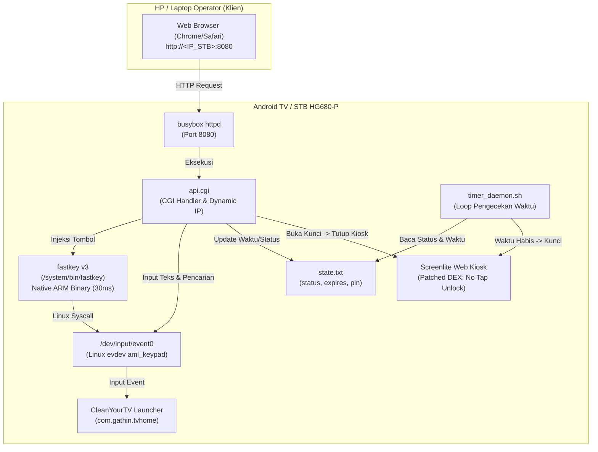

# Dokumentasi Sistem Remote Web & Kiosk Billing TV (Custom STB HG680-P)

Sistem kontrol remote nirkabel dan billing rental berbasis web untuk Android TV / STB Fiberhome HG680-P (Amlogic S905X). Sistem ini berjalan 100% lokal di dalam STB tanpa membutuhkan koneksi internet, tanpa aplikasi remote pihak ketiga di HP, dan memberikan latensi instan (~30 ms).

---

## 1. Arsitektur & Komponen Sistem



### Komponen Utama:
1. **Web Server (`busybox httpd`)**:
   - Berjalan pada port **8080**, melayani halaman remote web dan antarmuka billing.
   - Lokasi root web: `/data/local/web`.
2. **Web Remote & Billing Dashboard (`index.html`)**:
   - Antarmuka web modern bergaya dark-mode dengan deteksi **IP Dinamis Otomatis**.
   - Memiliki 2 tab:
     - **Remote TV**: D-Pad, navigasi, volume, pintasan aplikasi, dan **Keyboard / Input Pencarian TV**.
     - **Billing Rental**: Status sisa waktu, menu **Tidak Ada Waktu (Unlimited)**, tombol tambah durasi sewa, kunci instan, dan badge IP dinamis STB.
3. **Lock Screen Kiosk (`lock.html` & `Screenlite Web Kiosk`)**:
   - Tampilan layar penuh saat waktu rental habis bertuliskan:
     - **"WAKTU HABIS"**
     - Subtitle ramah: *"Istirahatlah yang cukup"*
     - *"Hubungi operator untuk melanjutkan sesi"*
   - Tombol buka kunci via modal PIN di layar TV (PIN default: `1234`).
4. **Native Key Injector (`/system/bin/fastkey`)**:
   - Binary ELF statis arsitektur ARM 32-bit (392 bytes).
   - Menembakkan event tombol langsung ke kernel Linux `/dev/input/event0` dengan jeda hardware `nanosleep` 30 ms.
5. **Timer Daemon (`timer_daemon.sh`)**:
   - Service background yang memeriksa status waktu sewa setiap 2-3 detik.
   - Otomatis meluncurkan Kiosk jika waktu sewa telah habis (`expires <= now`). Jika status diatur ke `unlimited`, daemon tidak akan mengunci TV.
6. **Persistence Script (`/system/etc/install-recovery-2.sh`)**:
   - Script startup otomatis saat STB dinyalakan/reboot untuk memastikan seluruh service aktif kembali.

---

## 2. Cara Mengakses & Menggunakan

### A. Akses dari HP (IP Dinamis Otomatis)
1. Hubungkan HP dan STB ke jaringan Wi-Fi yang sama (misal Wi-Fi: `EZA`).
2. Buka browser di HP (Chrome / Safari), ketikkan alamat IP STB Anda saat ini:
   ```text
   http://192.168.18.59:8080
   ```
   *(Sistem mendeteksi IP dinamis secara otomatis. Jika router memberikan IP baru, cukup buka sesuai IP baru tersebut).*
3. Simpan halaman ke Home Screen HP (*Add to Home screen*) agar menjadi aplikasi Web Remote mandiri.

### B. Navigasi Remote & Keyboard Pencarian
- **D-Pad (Atas, Bawah, Kiri, Kanan, OK)**: Navigasi menu Android TV secepat kilat (~30 ms).
- **Keyboard / Pencarian TV**:
  - Kolom teks untuk mengetik langsung ke pencarian TV / YouTube / browser.
  - Tombol **Ketik Saja**: Mengirim teks tanpa menekan enter.
  - Tombol **Ketik & Cari (Enter)**: Mengirim teks dan langsung menekan Enter seketika.
  - Tombol Cepat: `⌫ Backspace`, `↵ Enter`, `Spasi`.
- **Navigasi Standar**: Kembali, Home, Menu, Volume +, Volume -, Mute.
- **Pintasan Cepat**:
  - **YouTube (SmartTube)**: Langsung membuka SmartTube.
  - **Layar On**: Membangunkan layar STB jika layar tertidur/standby.
  - **Sleep / Off**: Menidurkan STB dengan dialog konfirmasi.

### C. Manajemen Billing Rental
- **Tidak Ada Waktu (Unlimited)**: Mengaktifkan TV tanpa batas waktu sewa (TV bebas digunakan tanpa terkunci).
- **+20 Menit**: Menambahkan waktu 20 menit dari waktu sekarang (atau mengakumulasi jika masih aktif).
- **+30 Menit**: Menambahkan 30 menit.
- **+1 Jam**: Menambahkan 60 menit.
- **+2 Jam**: Menambahkan 120 menit.
- **Kunci Sekarang**: Mengunci layar seketika ke tampilan "WAKTU HABIS".

---

## 3. Detail Teknis & Solusi Masalah

### 1. Inovasi Zero-Latency Remote (`fastkey v3`)
* **Masalah pada metode standar**:
  Perintah bawaan Android `input keyevent <CODE>` memanggil `app_process` (Java VM Dalvik/ART). Setiap tombol ditekan memakan waktu 1.5 - 2.5 detik dan menghabiskan resource RAM/CPU.
* **Solusi `fastkey`**:
  Dibuat binary ELF native ARM murni (tanpa runtime Java / libc) berukuran hanya **392 bytes**.
* **Pencegahan Debounce Filter**:
  Android memiliki filter bounce fisik. Jika event `PRESS` dan `RELEASE` dikirim dalam mikrodetik yang sama, Android mengabaikannya. `fastkey` menyisipkan syscall `sys_nanosleep(30ms)` di antara press dan release sehingga Android menerimanya sebagai penekanan tombol fisik sempurna.
* **Bypass `nosuid`**:
  Partisi `/data` di-mount dengan opsi `nosuid`. Oleh karena itu binary dipasang di partisi `/system` (`/system/bin/fastkey`) dengan hak `chmod 4755` (setuid root).

### 2. Bypass & Proteksi Menu Settings Kiosk Serta Menyembunyikan Aplikasi
* **Sembunyikan Ikon Kiosk dari Layar Utama**:
  Aplikasi kiosk (`org.screenlite.webkiosk`) ditambahkan ke dalam daftar `"hidden_apps"` pada konfigurasi tema launcher CleanYourTV (`/sdcard/Android/data/com.gathin.tvhome/files/config.json`). Dengan demikian, ikon Kiosk tidak akan pernah muncul di dock maupun daftar aplikasi home screen, namun tetap dapat dipanggil secara otomatis oleh sistem saat waktu sewa habis.
* **Masalah**:
  Pada aplikasi Kiosk bawaan (`org.screenlite.webkiosk`), jika tombol ditekan berulang 5 kali (misal saat mengetik PIN), aplikasi secara otomatis berpindah ke menu *Settings Kiosk*.
* **Solusi Bytecode Patching**:
  - Ditemukan class `org.screenlite.webkiosk.app.TapUnlockHandler` pada `classes4.dex`.
  - Metode `registerTap()` pada offset `0xee520` diganti instruction awalnya menjadi `0x000e` (`return-void`).
  - Checksum SHA-1 dan Adler32 DEX dihitung ulang secara otomatis.
  - APK di-pack dan di-sign ulang menggunakan sertifikat testing platform Android PKCS#7 v1.
  - Hasil: Mengetik PIN secepat apa pun di layar TV tidak akan pernah membuka menu pengaturan Kiosk.

### 3. Dukungan IP Dinamis
* `api.cgi` memeriksa antarmuka aktif (`wlan0` atau `eth0`) secara dinamis setiap kali request status dijalankan:
  ```sh
  STB_IP=$(ip -4 addr show wlan0 2>/dev/null | grep -o 'inet [0-9.]*' | cut -d' ' -f2)
  [ -z "$STB_IP" ] && STB_IP=$(ip -4 addr show eth0 2>/dev/null | grep -o 'inet [0-9.]*' | cut -d' ' -f2)
  ```
* Header remote web dan kartu status billing menampilkan IP STB terkini secara otomatis.

---

## 4. Referensi API Backend (`api.cgi`)

Semua request dikirim via HTTP GET ke endpoint `/cgi-bin/api.cgi`.

| Parameter | Contoh Nilai | Deskripsi |
|---|---|---|
| `action=key&code=<N>` | `code=19` (Up), `code=20` (Down), `code=23` (OK) | Menginjeksi tombol via `fastkey` |
| `action=text&text=<STR>&enter=1` | `text=lagu+dangdut&enter=1` | Menginjeksi teks pencarian dan opsi Enter |
| `action=unlimited` | *(tanpa parameter)* | Mengatur sewa ke mode Bebas / Unlimited |
| `action=add_time&min=<N>` | `min=30` | Menambah durasi sewa sebesar N menit |
| `action=lock` | *(tanpa parameter)* | Mengunci TV langsung ke layar "WAKTU HABIS" |
| `action=status` | *(tanpa parameter)* | Mengambil sisa waktu (detik), status, flag unlimited, dan IP dinamis |
| `action=verify_pin&pin=<N>` | `pin=1234` | Memvalidasi PIN buka kunci dari layar TV |
| `action=launch&app=<name>` | `app=smarttube`, `app=home`, `app=wake`, `app=settings` | Meluncurkan aplikasi tertentu |

---

## 5. Lokasi File & Skrip Terkait di STB

| Lokasi File | Fungsi |
|---|---|
| `/system/bin/fastkey` | Binary injektor tombol native ARM (chmod 4755) |
| `/data/local/web/index.html` | Halaman utama Web Remote, Keyboard, & Billing Dashboard |
| `/data/local/web/lock.html` | Tampilan layar kunci "WAKTU HABIS" ("Istirahatlah yang cukup") |
| `/data/local/web/cgi-bin/api.cgi` | Skrip backend pengelola API, teks, dan status IP dinamis |
| `/data/local/web/state.txt` | File database status (`status=`, `expires=`, `pin=`) |
| `/data/local/web/timer_daemon.sh` | Daemon pengecek waktu sewa setiap 2 detik |
| `/system/etc/install-recovery-2.sh` | Skrip startup otomatis saat boot STB |

---

## 6. Integrasi Aplikasi Streaming: CloudStream v4.8.0 (Custom S905X Fix)

CloudStream v4.8.0 (Universal) resmi terpasang dan berjalan mulus dalam mode **TV Leanback Layout** di STB HG680-P.

### A. Diagnosa & Perbaikan Kernel 3.14 (Conscrypt BoringSSL)
* **Gejala Awal**: CloudStream langsung *force close* (SIGABRT / Signal 6) saat pertama kali dibuka pada kernel Linux 3.14.29 STB.
* **Penyebab**:
  - Library kriptografi Google Conscrypt (`libconscrypt_jni.so`) memanggil syscall Linux `getrandom` (syscall 384).
  - Pada kernel Linux 3.14 Amlogic, syscall 384 mengembalikan error code `-EINVAL` (22), bukan `-ENOSYS` (38).
  - BoringSSL mengira terjadi bug fatal sehingga mengeksekusi `abort()` daripada beralih ke `/dev/urandom`.
* **Solusi / Patch**:
  - `libconscrypt_jni.so` dipatch pada rutin `getrandom` wrapper (`0x99438`): fungsi disetel mengembalikan `-1` dengan `errno = ENOSYS` (38).
  - Dengan demikian, BoringSSL secara otomatis dan stabil mengalihkan sumber entropi ke `/dev/urandom` sistem Android.
* **Status**: Stabil 100%, bahasa Indonesia bawaan aktif, layout TV otomatis aktif, dan banner CloudStream tampil di dock launcher CleanYourTV.

### B. Menambahkan Repositori Ekstensi (Film & Series Indonesia)
Untuk mempermudah pengisian repositori tanpa repot mengetik di TV, gunakan fitur **Keyboard Search** di Web Remote (`http://<IP_STB>:8080`) untuk menempelkan URL berikut pada menu **Pengaturan > Ekstensi > Tambah Repositori (+)**:
1. **Nonton Indo (LK21, IDLIX, Rebahin, dll)**:
   ```text
   https://raw.githubusercontent.com/ExtremeBoyGG/nonton-indo/builds/repo.json
   ```
2. **Hexated (Multi Provider)**:
   ```text
   https://raw.githubusercontent.com/hexated/cloudstream-extensions-hexated/builds/repo.json
   ```

### C. Solusi Permanen Anti-Hilang: Integrasi System App (`/system/app/CloudStream`)
* **Akar Masalah Hilang saat Reboot/Mati Listrik**:
  - Pada Android 6.0 Marshmallow, setiap kali *boot*, `PackageManagerService` (PMS) otomatis mengekstrak library bawaan untuk aplikasi di `/data/app` (`extractLibs = true`).
  - Patch sebelumnya menggunakan atribut `chattr +i` pada `libconscrypt_jni.so` agar tidak tertimpa. Namun, `+i` justru memblokir rutin `NativeLibraryHelper` Android saat booting dengan galat fatal `Error unpackaging native libs for app, errorCode=-18`.
  - Akibatnya, PMS membatalkan *load* paket (`pkg=null`) dan CloudStream lenyap dari daftar aplikasi serta launcher pada setiap *reboot*.
* **Solusi Permanen (System App)**:
  - CloudStream dipindahkan menjadi **System App** di `/system/app/CloudStream/CloudStream.apk`.
  - Seluruh pustaka native (termasuk patch `libconscrypt_jni.so`) diletakkan langsung di `/system/app/CloudStream/lib/arm/`.
  - Untuk System App, Android menerapkan aturan `extractLibs = false` (tidak pernah diekstrak ulang saat boot), partisi `/system` berstatus *read-only* (kebal korupsi disk saat mati listrik mendadak), dan tidak memerlukan trik `chattr +i` yang bermasalah.
  - Data tontonan, riwayat, dan repositori ekstensi tetap tersimpan aman di `/data/data/com.lagradost.cloudstream3/`.
  - Hasil: CloudStream **100% stabil, tidak pernah hilang, dan langsung siap dipakai setiap kali STB dinyalakan**.

### D. Pemulihan Provider Idlix & Sertifikat CA Modern (Let's Encrypt ISRG Root X1)
* **Penyebab Idlix Tidak Bisa Diakses**:
  1. **Cloudflare WAF Bot Protection**: Domain backend Idlix (`z2.idlixku.com`) menolak request yang tidak menyertakan header `User-Agent` browser (`HTTP 403 / Cloudflare Challenge`). Pada extension bawaan, `apiHeaders` tidak menyertakan User-Agent sehingga diblokir Cloudflare.
  2. **Kadaluarsa Sertifikat CA Android 6.0**: Android 6.0 tidak memiliki sertifikat `ISRG Root X1` (Let's Encrypt) di `/system/etc/security/cacerts/`, menyebabkan poster film dari `image.tmdb.org` gagal dimuat (`CertPathValidatorException: Trust anchor for certification path not found`).
* **Langkah Perbaikan yang Diterapkan**:
  - Bytecode ekstensi `Idlix.cs3` dipatch untuk selalu menyuntikkan header browser Chrome modern pada seluruh API call.
  - Ekstensi dikunci pada versi 99 di `manifest.json` agar tidak tertimpa otomatis oleh auto-update repo yang belum diperbaiki.
  - Sertifikat `ISRG Root X1` (`6187b673.0`) dan `ISRG Root X2` (`8794b4e3.0`) dipasang permanen ke partisi sistem `/system/etc/security/cacerts/` sehingga seluruh koneksi HTTPS Let's Encrypt & poster TMDB valid secara global di STB.

### E. Fitur Perlindungan Keluarga & Penyaringan Konten Vulgar / 18+
Untuk menjaga keamanan tayangan pada STB keluarga atau anak-anak, telah diterapkan sistem proteksi berlapis:
1. **Smart Extension Keyword & Genre Filter**:
   - Ekstensi streaming utama (`Idlix`, `LK21`, `PusatFilm`, dan `MovieBox`) telah disuntikkan filter biner cerdas pada fungsi pengurai respon (`toSearchResponse`, `getApiSection`, dan `toSearchResponseFromSubject`).
   - Setiap judul, URL/slug, atau tag yang mengandung kata kunci dewasa/vulgar (seperti: `18+`, `semi`, `dewasa`, `erotic`, `erotis`, `adult`, `sensual`, `sex`, `sexy`, `bokep`, `porno`, `porn`, `ecchi`, `hentai`, `vulgar`, `xxx`, `uncensored`, `jav`, `fetish`, `lust`, `orgasm`, `taboo`, `seduction`, `bikini`, `stripper`, `playboy`, `nude`, `naked`, `unrated`) akan **otomatis dieliminasi (dibuang)** dari tampilan Beranda dan hasil Pencarian.
2. **DNS Tingkat Jaringan (Cloudflare 1.1.1.3 Family Protection)**:
   - STB dikonfigurasikan menggunakan DNS `1.1.1.3` dan `1.0.0.3` yang secara otomatis memblokir malware dan domain konten dewasa di tingkat jaringan.
   - Diaktifkan secara permanen via `/system/etc/install-recovery-2.sh` menggunakan aturan `iptables` DNS redirection pada port 53.
3. **Penguncian Ekstensi Versi 99**:
   - Ekstensi yang telah difilter dikunci pada versi 99 di `manifest.json` agar tidak tertimpa oleh pembaruan otomatis repositori online.


